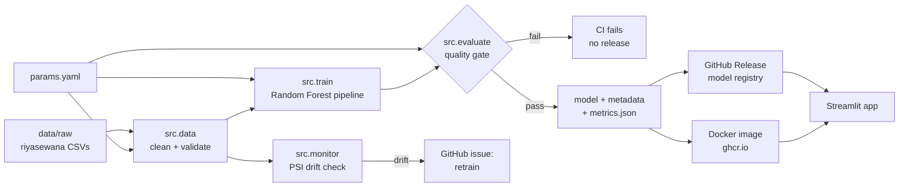

# Lanka Car Valuation: MLOps

[](https://github.com/dulshandadallege/lanka-car-valuation-mlops/actions/workflows/ci.yml)
[](https://github.com/dulshandadallege/lanka-car-valuation-mlops/actions/workflows/cd.yml)
[](https://github.com/dulshandadallege/lanka-car-valuation-mlops/actions/workflows/monitor.yml)

This project estimates the fair **asking price of a used car in Sri Lanka** from its listing details, explains each
estimate with SHAP, and runs on a full MLOps pipeline covering reproducible training, a quality gate, versioned
releases, container delivery and drift monitoring.

*IT5514 Applied Machine Learning, final assignment, MSc in AI (University of Moratuwa).*

| Test MAE | MAPE | R² | Priced within ±10% |
|---|---|---|---|
| Rs 764,419 | 8.07% | 0.917 | 78.9% |

**Live demo:** _add the Streamlit Community Cloud URL here after deploying (see below)_

## How the pipeline works



| Stage | What happens | Where |
|---|---|---|
| **Pull request** → CI | ruff lint → unit + data-validation tests → train → **quality gate** → model tests → Docker build + health check | `.github/workflows/ci.yml` |
| **Merge to `main`** → CD | retrain → gate → push image `ghcr.io/dulshandadallege/lanka-car-valuation-mlops:latest` | `.github/workflows/cd.yml` |
| **Tag `vX.Y.Z`** → release | the same, plus a GitHub Release holding the model, `metrics.json` and the model card | `.github/workflows/cd.yml` |
| **Every Monday** → monitor | Population Stability Index per feature; opens a retraining issue on significant drift | `.github/workflows/monitor.yml` |

**Reproducibility.** Every setting lives in `params.yaml`. Each saved model carries its version, a SHA-256
fingerprint of the training data, its parameters, its metrics and the library versions. Running the pipeline
reproduces the notebook's results exactly.

## Run it locally

Requires Python 3.12 or newer.

```bash
python -m venv .venv && source .venv/bin/activate
pip install -r requirements-dev.txt

python -m src.pipeline --version local    # train + evaluate + gate  (~15 s)
pytest                                    # 22 tests
streamlit run app/app.py                  # http://localhost:8501
python -m src.predict data/new_listings_unseen.csv
python -m src.monitor                     # drift: latest month vs earlier months
```

On macOS, `brew install libomp` is needed for the notebook's XGBoost and LightGBM. The research notebook
(`Vehicle_Price_Prediction_SL.ipynb`: EDA, comparison of seven models, SHAP, LIME) needs
`pip install -r requirements-notebook.txt`.

## Deploy

- **Streamlit Community Cloud:** share.streamlit.io → *Create app* → this repo, branch `main`, file `app/app.py`,
  Python 3.12. On first start the app downloads the model from the latest GitHub Release, so no binaries live in git.
- **Docker / any container host** (Azure Container Apps, AWS App Runner, Cloud Run):
  ```bash
  docker run -p 8501:8501 ghcr.io/dulshandadallege/lanka-car-valuation-mlops:latest
  ```

## Repository layout

```
src/            data.py · features.py · train.py · evaluate.py · pipeline.py · predict.py · monitor.py
app/            Streamlit app (estimate, fair range, verdict, SHAP reasons, what-if)
tests/          data validation, features, model behaviour, drift monitor
data/raw/       raw listings + SOURCE.md (credit and licence)
params.yaml     every pipeline setting and the quality-gate thresholds
MODEL_CARD.md   intended use, data, metrics, limitations
```

## Data credit
The raw listings come from [savindu777/Sri-Lanka-Car-Market-Anlaysis-2026](https://github.com/savindu777/Sri-Lanka-Car-Market-Anlaysis-2026)
(MIT, scraped from riyasewana.com). See `data/raw/SOURCE.md`.
